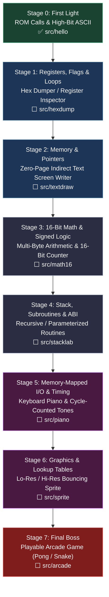

# 6502 Mastery Roadmap (Apple IIe)

A hands-on, project-driven roadmap to **truly master the MOS 6502** on the Apple IIe—designed to build deep, transferable low-level intuition before moving on to modern architectures (ARM64, RISC-V, x86-64).

---

## Visual Progression

---

## Stage-by-Stage Curriculum

### Stage 0 — First Light *(Completed)*
> **Project:** `src/hello/hello.s`

- [x] Assemble (`ca65`), link (`ld65`), inject onto DOS 3.3 disk (`ac.jar`), and `BRUN` in Linapple
- [x] Call Apple II Monitor ROM routines (`HOME`, `COUT`) and handle Apple II high-bit ASCII
- [x] Understand register clobbering across OS/ROM boundaries (DOS 3.3 `COUT` clobbering `X`)

---

### Stage 1 — Registers, Flags & Branching
> **Project:** `src/hexdump/hexdump.s` — A live memory hex dumper (like a mini System Monitor)

- [ ] Master `N`, `Z`, `C`, `V` status flags and how `CMP`/`CPX`/`CPY` set them
- [ ] Write nested loops using `X` and `Y` without clobbering state
- [ ] Format bytes as hex ASCII yourself (nibbles via `LSR`, `AND #$0F`, lookup table) instead of calling `PRBYTE`
- [ ] **Challenge:** Dump 128 bytes starting at `$6000` in `ADDR: XX XX ... | ASCII` rows
- **Modern CPU Bridge:** Maps directly to `CMP`/`SUBS` + condition codes (`BEQ`/`BNE`/`BLO`/`BHS`) on ARM & x86.

---

### Stage 2 — Zero Page & Indirect Addressing (Pointers!)
> **Project:** `src/textdraw/textdraw.s` — Direct Text Page 1 (`$0400`–`$07FF`) screen writer & box drawer

- [ ] Understand why Zero Page (`$00`–`$FF`) acts like an extended register file
- [ ] Master `(zp),Y` **Indirect Indexed** addressing to walk arbitrary 16-bit memory buffers > 256 bytes
- [ ] Write directly to Apple II Text Page 1 memory (bypassing `COUT` completely) and handle its non-linear row layout with a row-address lookup table (`LO`/`HI` byte split tables!)
- [ ] **Challenge:** Draw a bordered title box and print centered inverse/flashing/normal text directly to VRAM
- **Modern CPU Bridge:** This *is* pointer arithmetic (`*(ptr + i)`), struct-of-arrays (`LO[]`/`HI[]`), and base+offset addressing.

---

### Stage 3 — 16-Bit Arithmetic, Signed Numbers & Bitwise Ops
> **Project:** `src/math16/math16.s` — 16-bit calculator / Fibonacci & signed comparison demo

- [ ] Implement 16-bit addition (`CLC` + `ADC` chain) and 16-bit subtraction (`SEC` + `SBC` chain)
- [ ] Implement unsigned 8×8 → 16-bit multiply using shift-and-add (`ASL`, `LSR`, `ROL`, `ROR`)
- [ ] Master two's complement signed comparisons using `N` and `V` flags (`BMI`/`BPL`/`BVC`/`BVS`)
- [ ] **Challenge:** Convert a 16-bit binary integer to decimal ASCII and print it on screen
- **Modern CPU Bridge:** Teaches carry propagation, overflow vs. carry, and what `MUL`/`DIV` hardware instructions do under the hood.

---

### Stage 4 — The Hardware Stack, Calling Conventions & Jump Tables
> **Project:** `src/stacklab/stacklab.s` — Mini command parser with jump table & reusable routines

- [ ] Understand the 6502 hardware stack (`$0100`–`$01FF`), `PHA`/`PLA`, `PHP`/`PLP`, `TSX`/`TXS`
- [ ] Design your own **calling convention** (register args vs. zero-page args vs. stack-saved callee registers)
- [ ] Implement an indirect **jump table** (`JMP (ptr)` or RTS-trick dispatch) for a key-driven menu
- [ ] Inspect `$0100`–`$01FF` live in Linapple's debugger / Monitor (`CALL -151`) to watch return addresses (`PC - 1`) get pushed and popped
- **Modern CPU Bridge:** Foundation for x86/ARM ABI, stack frames, `CALL`/`RET`, and `switch` jump tables.

---

### Stage 5 — Memory-Mapped I/O & Cycle-Accurate Timing
> **Project:** `src/piano/piano.s` — Interactive keyboard synthesizer using the Apple II speaker

- [ ] Poll hardware soft switches directly: `$C000` (keyboard data + strobe bit 7) and `$C010` (clear keyboard strobe)
- [ ] Toggle `$C030` (`SPEAKER`) in deterministic **cycle-counted delay loops** to produce accurate musical pitches (1.023 MHz clock!)
- [ ] Count exact instruction cycles (e.g., `DEX` = 2, `BNE` taken = 3, page-crossing penalty = +1)
- [ ] **Challenge:** Map keys `A`–`K` to a full octave of clean musical notes with zero ROM calls
- **Modern CPU Bridge:** Bare-metal MMIO polling, clock-cycle budgeting, and hardware timing (embedded/kernel dev).

---

### Stage 6 — Bitmapped Graphics, Soft Switches & Lookup Tables
> **Project:** `src/sprite/sprite.s` — Smoothly animated Lo-Res (`$C050`/`$C056`) or Hi-Res (`$2000`–`$3FFF`) bouncing sprite

- [ ] Flip Apple II display soft switches (`TXTCLR` `$C050`, `TXTSET` `$C051`, `MIXCLR` `$C052`, `HIRES` `$C057`)
- [ ] Precompute coordinate-to-address lookup tables (`Y_LO`, `Y_HI`) to replace expensive runtime math
- [ ] Implement erase/draw or page-flipping (`PAGE1` `$C054` / `PAGE2` `$C055`) to eliminate flicker
- [ ] **Challenge:** Move a sprite with keyboard controls (`I`/`J`/`K`/`L`) bounded cleanly to screen edges
- **Modern CPU Bridge:** Framebuffers, double buffering, bit-blitting, and space-vs-time tradeoffs.

---

### Stage 7 — Final Boss: A Complete Playable Game
> **Project:** `src/arcade/arcade.s` — Snake, Pong, or Breakout in pure 6502 assembly

- [ ] Combine everything: structured state machine, multi-file `src/arcade/*.s` project, zero-page variables, MMIO input, sound effects, collision detection, and score display
- [ ] Keep a clean main game loop (`Input → Update → Render → Sound/Delay`)
- [ ] Debug and profile using Linapple's integrated debugger (`F7` / Monitor)

---

## 6502 → Modern Architecture Cheat Sheet

Once you finish this roadmap, you already know the core mental model behind every modern CPU:

| 6502 Concept | x86-64 Equivalent | ARM64 / RISC-V Equivalent |
| :--- | :--- | :--- |
| Zero Page (`$00`–`$FF`) | General-purpose registers (`RAX`–`R15`) | `X0`–`X30` / `x1`–`x31` |
| `P` flags (`N Z C V`) | `RFLAGS` (`SF ZF CF OF`) | `NZCV` (ARM64) / branch-compare (RISC-V) |
| `(zp),Y` Indirect Indexed | `[base + idx]` | `[Xn, Xm]` / `lw rd, imm(rs1)` |
| `JSR` / `RTS` + `$0100` stack | `CALL` / `RET` + `RSP` | `BL` / `RET` (`LR` + `SP`) |
| `$C000`–`$C0FF` Soft Switches | Memory-Mapped I/O (MMIO) | MMIO peripheral registers |
| Cycle counting (1.023 MHz) | Instruction latency & throughput | Pipeline stalls & cycle budgets |
